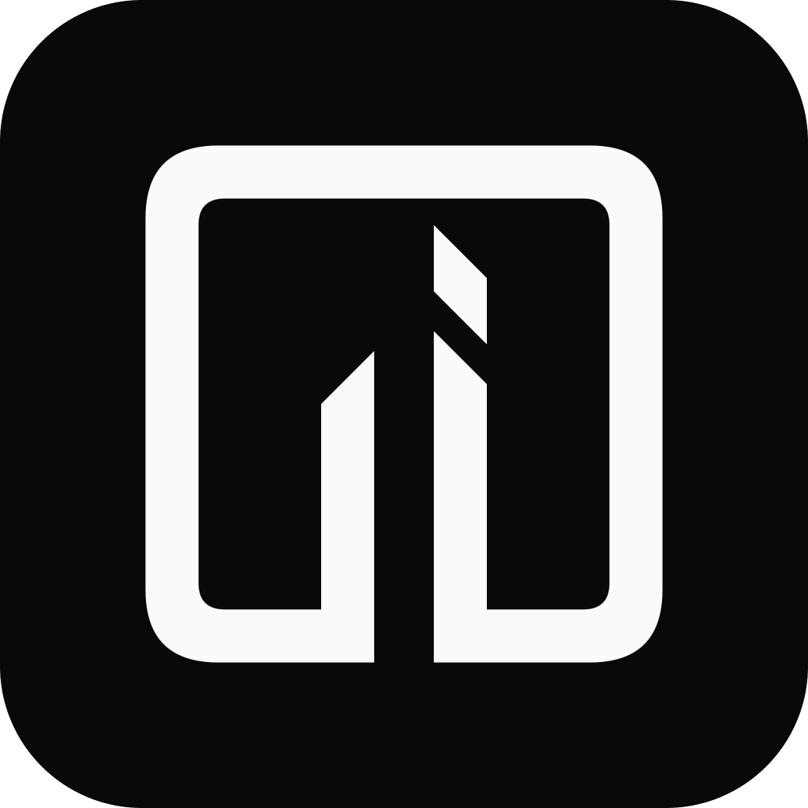
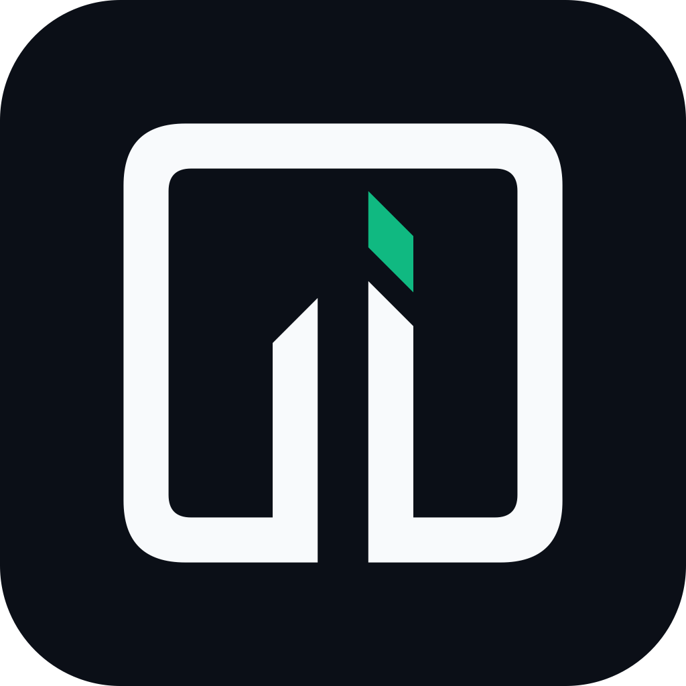
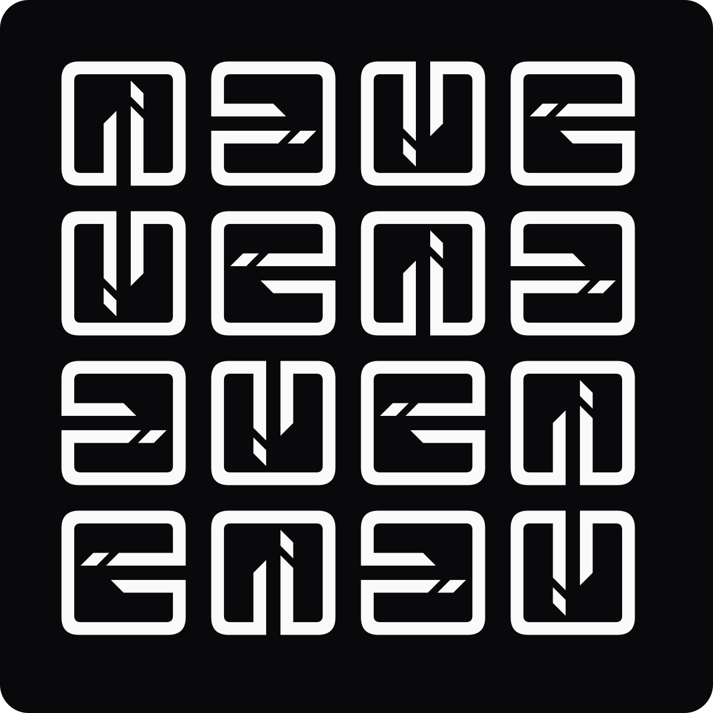
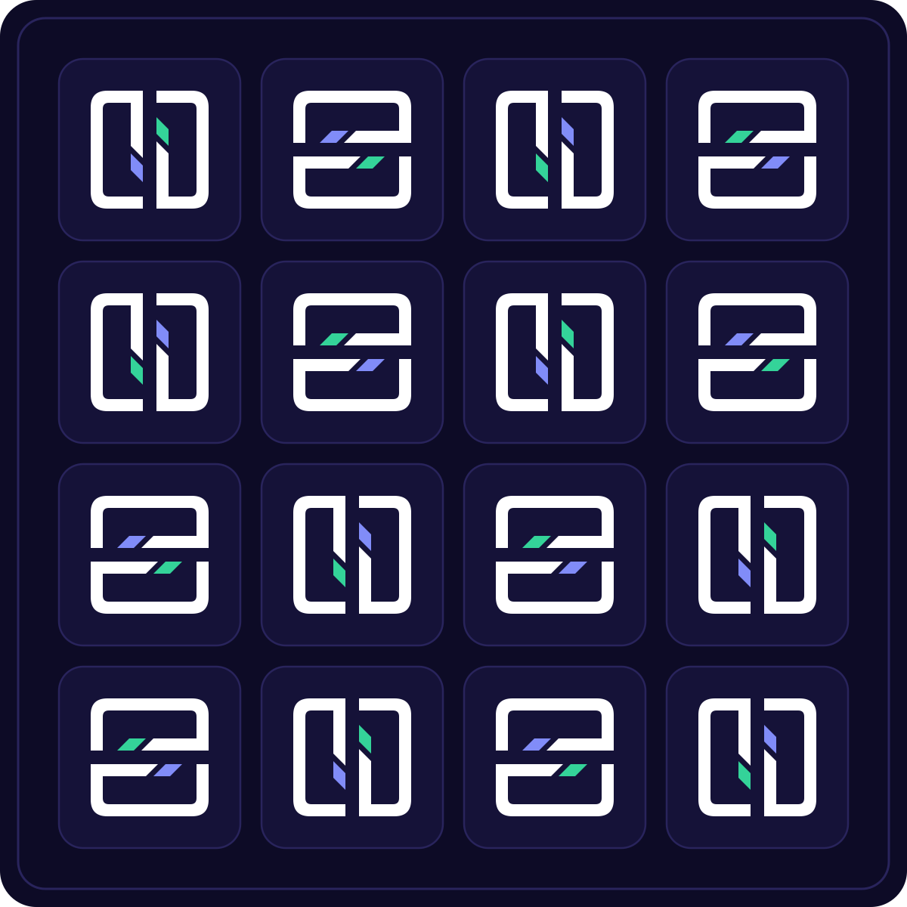

  <picture>
    <source media="(prefers-color-scheme: dark)" srcset="https://raw.githubusercontent.com/Rawased/.github/main/brand/rawased-banner-v3-bw-dark-1600x500.png?v=k3-v2">
    <source media="(prefers-color-scheme: light)" srcset="https://raw.githubusercontent.com/Rawased/.github/main/brand/rawased-banner-v3-bw-light-1600x500.png?v=k3-v2">
    
  </picture>

   

  <h2>Rawased (رواصد) · Price feeds miss the footnotes. Rawased reads them.</h2>
  
<b>«شاشات الأسعار تغفل الإيضاحات. رواصد تقرأها من المصدر.»</b>

---

## Approved `K3` Brand Kit (`brand/`)

| `K3` Monochrome Dark (`1024px`) | `K3` Sovereign Slate + `#10B981` Facet | `K3` Frameless `4x4` Rotational Matrix | `K3` Midnight Indigo `4x4` Matrix |
| :---: | :---: | :---: | :---: |
|  |  |  |  |
| [`rawased-mark-bw-dark.svg`](./brand/rawased-mark-bw-dark.svg) | [`rawased-mark-sovereign-slate.svg`](./brand/rawased-mark-sovereign-slate.svg) | [`rawased-pattern-4x4-bw-dark.svg`](./brand/rawased-pattern-4x4-bw-dark.svg) | [`rawased-pattern-4x4-midnight-indigo.svg`](./brand/rawased-pattern-4x4-midnight-indigo.svg) |

See [`profile/README.md`](./profile/README.md) for the full Rawased Organization Main Menu (`https://github.com/Rawased`) and [`brand/`](./brand/) for the complete 6-palette `K3` vector and PNG brand kit.
