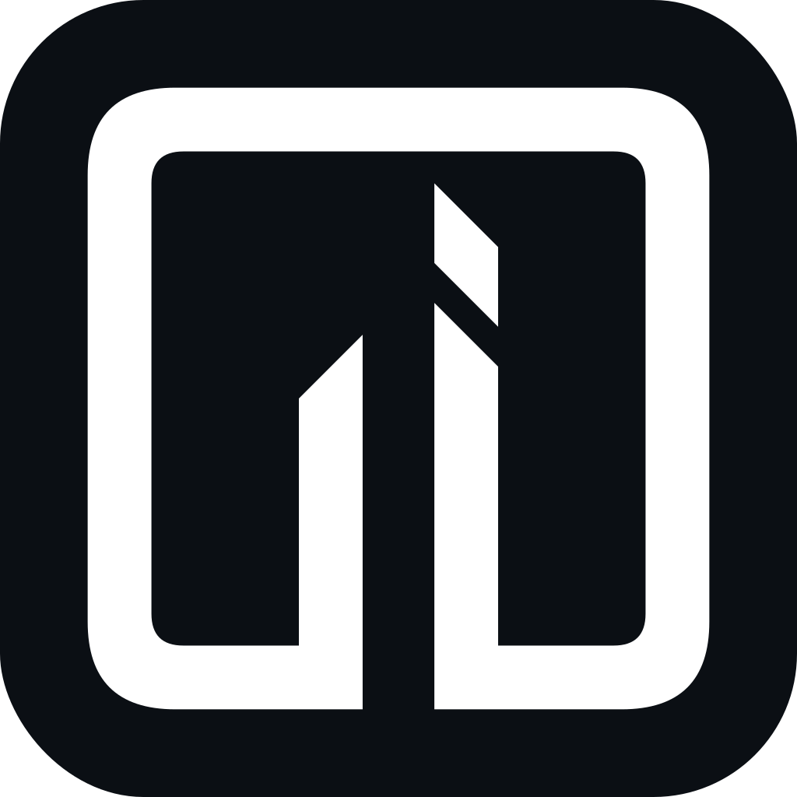
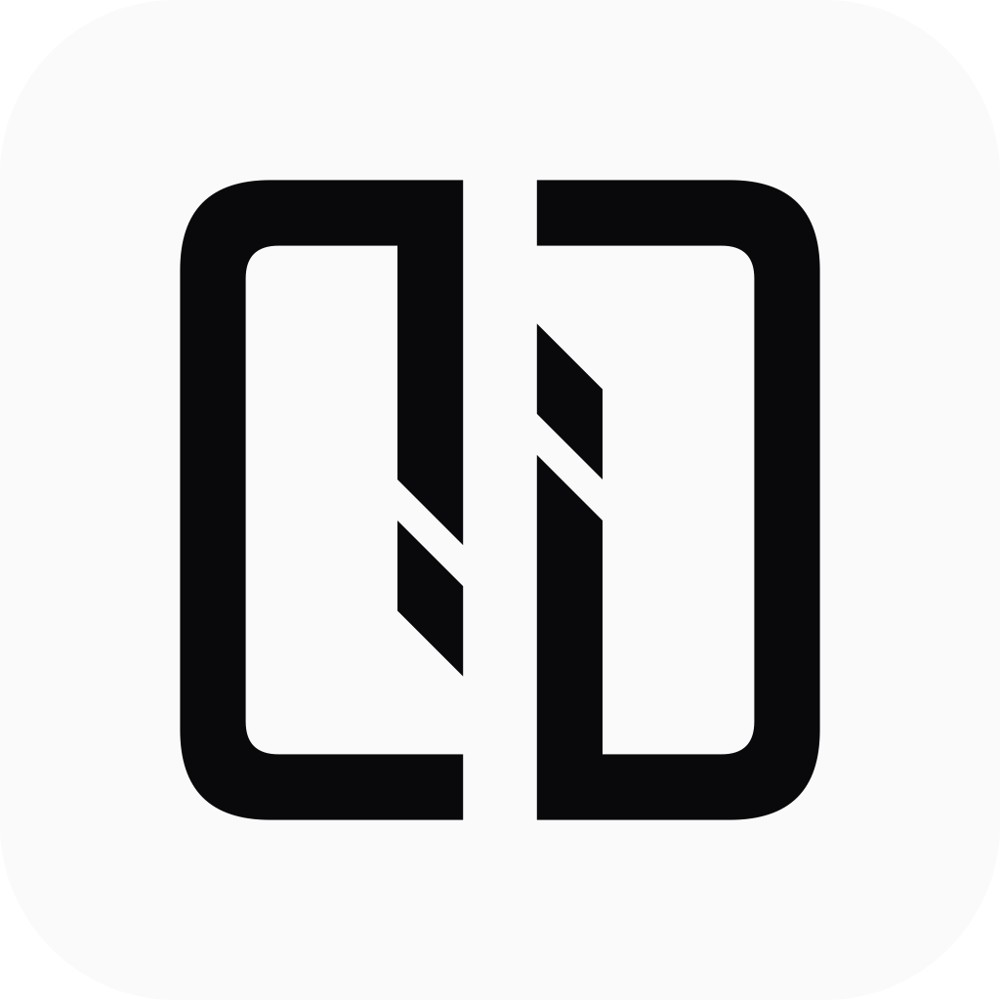
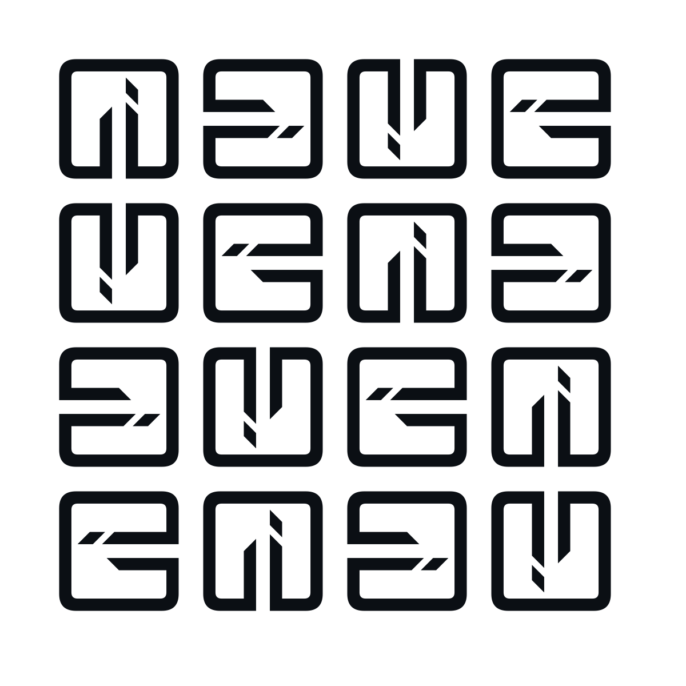

  <picture>
    <source media="(prefers-color-scheme: dark)" srcset="https://raw.githubusercontent.com/Rawased/.github/main/brand/rawased-banner-v3-bw-dark-1600x500.png?v=k3-v3">
    <source media="(prefers-color-scheme: light)" srcset="https://raw.githubusercontent.com/Rawased/.github/main/brand/rawased-banner-v3-bw-light-1600x500.png?v=k3-v3">
    
  </picture>

   

  <h2>Rawased (رواصد) · Price feeds miss the footnotes. Rawased reads them.</h2>
  
<b>«شاشات الأسعار تغفل الإيضاحات. رواصد تقرأها من المصدر.»</b>

---

## Approved `K3` Monochrome Brand Kit (`brand/logo/` & `brand/`)

| `K3` Master Icon (`brand/logo/icon-1024.png`) | `K3` Light Mark (`rawased-mark-bw-light-1024.png`) | `K3` `4x4` Rotational Matrix (Dark) | `K3` `4x4` Rotational Matrix (Light) |
| :---: | :---: | :---: | :---: |
|  |  |  |  |
| [`brand/logo/icon.svg`](./brand/logo/icon.svg) · [`rawased-k3-512.png`](./brand/rawased-k3-512.png) | [`rawased-mark-bw-light.svg`](./brand/rawased-mark-bw-light.svg) | [`rawased-pattern-4x4-bw-dark.svg`](./brand/rawased-pattern-4x4-bw-dark.svg) | [`rawased-pattern-4x4-bw-light.svg`](./brand/rawased-pattern-4x4-bw-light.svg) |

See [`profile/README.md`](./profile/README.md) for the full Rawased Organization Main Menu (`https://github.com/Rawased`) and [`brand/logo/`](./brand/logo/) for the complete icon ladder (`favicon-16.png` to `icon-1024.png`, `apple-touch-icon.png`, `maskable-512.png`, and `og.png`).
